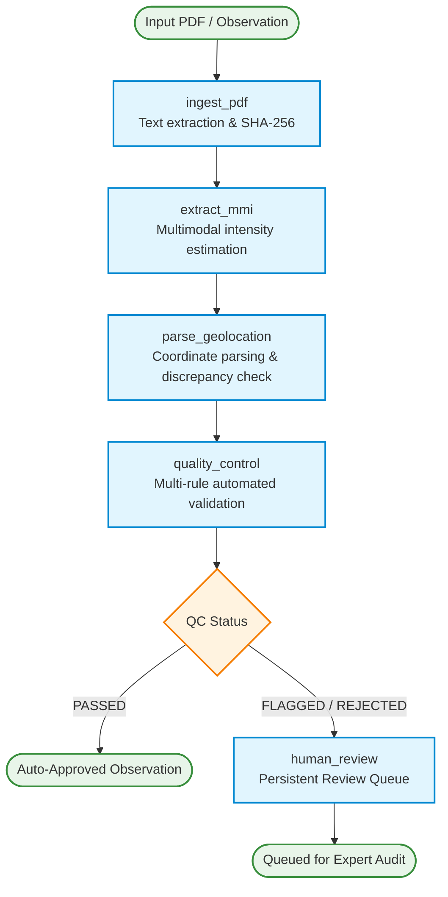

# 🏗️ MMI-Gram System Architecture & Agent Workflow

MMI-Gram is an agentic AI system for estimating Modified Mercalli Intensity (MMI) from post-earthquake reconnaissance reports, field imagery, and social media data. It couples multimodal language models with a rigorous engineering pipeline: deterministic coordinate extraction, multi-rule quality control (QC), and a persistent Human-in-the-Loop (HITL) review queue.

---

## 1. System Overview

```
                      +------------------------------------------+
                      |         Input Reconnaissance PDF          |
                      |   (e.g., StEER Field Briefing Page)      |
                      +--------------------+---------------------+
                                           |
                                           v
+-----------------------------------------------------------------------------------------+
| LangGraph State Machine                                                                 |
|                                                                                         |
|  [Node 1: Ingest PDF]                                                                   |
|      * Extract text & metadata using pypdf                                              |
|      * Compute SHA-256 integrity hash                                                   |
|      * Detect image-only scanned PDFs                                                   |
|            |                                                                            |
|            v                                                                            |
|  [Node 2: Extract MMI]                                                                  |
|      * Offline: Load recorded fixture without network or costs                          |
|      * Live: Authorized call via CRAGAdapter (Gemini + Pinecone)                        |
|      * Zero fabrication: Null/malformed model outputs remain null                       |
|            |                                                                            |
|            v                                                                            |
|  [Node 3: Parse Geolocation]                                                            |
|      * Parse DMS & decimal coordinates from document text                               |
|      * Extract coordinates from model output                                            |
|      * Haversine distance comparison between document & model                           |
|      * Preserve both document_coordinates and model_coordinates independently           |
|            |                                                                            |
|            v                                                                            |
|  [Node 4: Quality Control (QC)]                                                         |
|      * Rule 1: Reject Null Island (0.0, 0.0)                                            |
|      * Rule 2: Validate physical MMI range [1.0, 10.0]                                   |
|      * Rule 3: Check confidence threshold (< 0.60 flagged)                              |
|      * Rule 4: Flag coordinate discrepancies (> 10 km)                                  |
|      * Rule 5: Flag unestimated intensity (missing/null MMI)                            |
|      * Rule 6: Flag high intensity anomaly (MMI >= 9.0)                                 |
|            |                                                                            |
|            +-----------------------+-----------------------+                            |
|            | (QC Passed Cleanly)   | (Flagged or Rejected) |                            |
|            v                       v                       |                            |
|      [Auto-Approved]    [Node 5: Human Review Queue]       |                            |
|                                * Persistent JSON storage   |                            |
|                                * Audit reason triggers     |                            |
|                                * Expert review / override  |                            |
+--------------------------------------------+---------------+----------------------------+
                                             |
                                             v
                      +------------------------------------------+
                      | Structured Output (JSON / CSV / Summary) |
                      +------------------------------------------+
```

---

## 2. Implemented LangGraph Workflow

The operational pipeline is implemented using LangGraph and state dictionaries in `src/mmigram/workflow/`.



---

## 3. Core Data Contracts & State Schemas

The system enforces strict schema definitions defined in `src/mmigram/core/models.py`:

### `ObservationRecord`
```python
class ObservationRecord(BaseModel):
    observation_id: str
    source_type: str                  # "steer_report", "social_media", etc.
    file_path: Optional[str]
    document_text: Optional[str]
    sha256_hash: Optional[str]

    # Seismic Intensity
    seismic_intensity: SeismicIntensity
        mmi_estimation: Optional[float]   # 1.0 - 10.0, or None if unestimated
        confidence: Optional[float]       # 0.0 - 1.0, or None
        is_calibrated: bool               # True only after expert or empirical review
        reasoning: str

    # Geographic Resolution
    geographic_resolution: GeographicResolution
        coordinates: Optional[Coordinates]         # Primary active coordinates
        document_coordinates: Optional[Coordinates]# Parsed from source text
        model_coordinates: Optional[Coordinates]   # Generated by LLM
        comparison_status: str                     # COORDINATES_AGREE, COORDINATES_DISAGREE,
                                                   # MODEL_LOCATION_UNAVAILABLE, DOCUMENT_LOCATION_UNAVAILABLE,
                                                   # BOTH_LOCATIONS_UNAVAILABLE
        coordinates_disagree: bool
        discrepancy_distance_km: Optional[float]
        discrepancy_details: Optional[str]

    # Quality Control & Provenance
    quality_control: QualityControlResult
        status: str                      # "PASSED", "FLAGGED", "REJECTED"
        flags: List[str]
        score: float

    human_in_the_loop: HumanReviewStatus
        review_required: bool
        review_status: str               # "UNREVIEWED", "AUDITED", "OVERRIDDEN"
        triggers: List[str]

    provenance: ProvenanceMetadata
        is_synthetic: bool
        baseline_type: str               # "RECORDED_LEGACY_OUTPUT", "MOCKED_TEST_DATA", etc.
        is_authoritative_ground_truth: bool
```

---

## 4. Key Architectural Subsystems

### A. Geolocation Parsing & Location Status Taxonomy (`src/mmigram/geolocation/`)
- **Document coordinate extraction**: Scans raw document text using high-precision regex matching Degrees Minutes Seconds (DMS), Degrees Decimal Minutes (DDM), and Decimal Degrees (DD).
- **Coordinate discrepancy detection**: Calculates the great-circle distance (Haversine formula) between document coordinates and model-generated coordinates. If distance exceeds `10.0 km`, `coordinates_disagree` is set to `True`.
- **Location Status Taxonomy**:
  - `COORDINATES_AGREE`: Both sources valid, separation $\le$ 10.0 km.
  - `COORDINATES_DISAGREE`: Both sources valid, separation > 10.0 km (or model returned corrupted/invalid coordinates).
  - `MODEL_LOCATION_UNAVAILABLE`: Document text established valid coordinates, but model location was null/Unknown. *CRITICAL INVARIANT*: Missing model coordinates are never interpreted as agreement.
  - `DOCUMENT_LOCATION_UNAVAILABLE`: Model predicted coordinates, but document text lacked coordinates.
  - `BOTH_LOCATIONS_UNAVAILABLE`: Neither source established coordinates; candidate coordinates remain null.
- **Dual preservation**: Document coordinates and model coordinates are preserved separately in the output schema. MMI-Gram does not silently overwrite or assume either is ground truth without expert verification.

### B. Multi-Rule Quality Control (`src/mmigram/qc/`)
Rules are evaluated deterministically in `src/mmigram/qc/checker.py`:
1. `FLAG_NULL_ISLAND`: Triggers if latitude and longitude are both exactly `0.0`. Status set to `REJECTED`.
2. `FLAG_INVALID_MMI_RANGE`: Triggers if MMI < 1.0 or MMI > 12.0. Status set to `REJECTED`.
3. `FLAG_UNESTIMATED_INTENSITY`: Triggers if MMI is missing/null. Status set to `FLAGGED` (requires human review).
4. `FLAG_COORDINATE_DISCREPANCY`: Triggers when document and model coordinates disagree by > 10 km. Status set to `FLAGGED`.
5. `FLAG_MODEL_LOCATION_UNAVAILABLE`: Triggers when model coordinates were unavailable. Status set to `FLAGGED`.
6. `FLAG_HIGH_INTENSITY_ANOMALY`: Triggers when MMI >= 9.0. Status set to `FLAGGED` (requires expert corroboration).
7. `FLAG_LOW_CONFIDENCE`: Triggers when confidence < 0.75. Status set to `FLAGGED`.

### C. Persistent Human-in-the-Loop Review Queue (`src/mmigram/review/queue.py`)
- Observations failing QC or requiring validation are automatically routed to the review queue.
- Persists state to a structured local JSON file (`data/review_queue.json`) with file-locking and atomic writes.
- Survives process restarts and CLI runs.
- Tracks expert audit history, review status (`UNREVIEWED`, `AUDITED`, `OVERRIDDEN`), and override rationale.
- **Security-Sanitized**: Enqueued states scrub signed GCS URLs and API credentials before writing to disk.

### D. Structured Telemetry & Credential Redaction (`src/mmigram/telemetry/tracer.py`)
- Emits structured events whenever a LangGraph node starts or completes.
- Logs node execution timestamp (UTC), input state snapshot, output payload, and duration in milliseconds.
- **Security Redaction Engine**: Recursively filters GCS V4 signed URLs (`https://storage.googleapis.com/...?[REDACTED_SIGNATURE]`), Bearer tokens, and sensitive query parameters from terminal streaming, LangGraph node dumps, and persisted traces.

### E. Dependencies & SDK Modernization Roadmap
- **Current Integration**: Operates using Vertex AI via `google-cloud-aiplatform>=2.7.0` and `langchain-google-genai<3.0`, providing backward compatibility with Clara's original `MultimodalEarthquakeCRAG`.
- **Deprecation Notice**: Google has deprecated `vertexai.generative_models` in favor of the new unified `google-genai` SDK (`from google import genai`).
- **Roadmap**: A future milestone will migrate the invocation layer to `google-genai` while preserving the existing MMI-Gram LangGraph node contracts, state schemas, and redaction boundaries.

---

## 5. Distinction: Implemented vs. Planned Components

| Component | Status | Location | Notes |
| :--- | :--- | :--- | :--- |
| **PDF Ingestion & Text Extraction** | Implemented | `src/mmigram/ingestion/` | Uses `pypdf`, handles text and scanned PDFs |
| **Offline Fixture Replay** | Implemented | `src/mmigram/workflow/` | Zero-cost, 100% offline reproducible |
| **Live CRAG Adapter** | Implemented | `src/mmigram/adapters/` | Reuses Clara's CRAG, gated by explicit flag |
| **DMS Geolocation Parser** | Implemented | `src/mmigram/geolocation/` | Regex-based DMS/DD extraction |
| **Coordinate Discrepancy Detection** | Implemented | `src/mmigram/geolocation/` | Haversine distance, dual preservation |
| **Multi-Rule QC Engine** | Implemented | `src/mmigram/qc/` | 6 deterministic rules |
| **Persistent Review Queue** | Implemented | `src/mmigram/review/` | Local JSON atomic persistence |
| **Structured Telemetry** | Implemented | `src/mmigram/telemetry/` | Node timing & state logging |
| **Unified CLI** | Implemented | `src/mmigram/cli.py` | `demo`, `analyze`, `batch`, `test`, `check-env` |
| **Benchmark Comparator** | Implemented | `src/mmigram/comparison/` | JSON & CSV export for workflow comparison |
| **Reddit Social Connector** | Implemented (Offline) | `src/mmigram/ingestion/` | Normalization to `SocialPost` & metadata |
| **Live Social Discovery** | Planned | Future milestone | Gated on API credentials & platform terms |
| **Python-native GIS Mapping** | Planned | Future milestone | Geopandas/Folium/PyGMT layer |
