# 🏛️ Proposed Unified Architecture: MMI-Gram 2.0 (Integrated Estimator)

**Project:** Harvard EPS 55 Final Project (in collaboration with Clara Yoon, USGS)  
**Destination Repository:** `MMI-Gram`  
**Date:** November 14, 2026  
**Status:** Architecture Proposal for Expert Review  

---

## 1. Architectural Vision

The unified MMI-Gram pipeline combines the **scientific rigor, deterministic quality control, and LangGraph modularity** of MMI-Gram with the **local-first efficiency, 3D rupture distance physics, Google Maps geocoding, and USGS ShakeMap v4 data exports** of Clara Yoon's `quake_agent`.

```mermaid
flowchart TD
    subgraph Ingestion ["1. Local-First Ingestion"]
        Doc[Target Document / Image / Video] --> Extractor[PDF/Media Extractor<br/>Text + Metadata + SHA-256]
        EventConf[(event_config.json<br/>Hypocenter, Fault Trace, GMPE)] -.-> Extractor
    end

    subgraph PreFilter ["2. Multi-Gate Screening & Relevance Gate"]
        Extractor --> RelGate{Relevance Gate<br/>Observable damage photos?}
        RelGate -- "No (e.g. page-8.pdf)" --> NotEstimable[NOT_ESTIMABLE<br/>Reason: Briefing Cover/Methodology Slide]
        NotEstimable --> ExcludedLog[(Excluded Inputs Log<br/>Audit Record Preserved)]
        
        RelGate -- "Yes" --> TempGate[Temporal Gate<br/>Timestamp vs Origin T0]
        TempGate --> DupGate[Recycled Media Gate<br/>pHash & SHA-256 Duplicates]
        DupGate --> AuthGate[Authenticity Gate<br/>Fallible AI-Synthetic Screening]
    end

    subgraph Seismology ["3. LangGraph Multimodal Seismologist Agent"]
        AuthGate --> Stage1[Pass 1: Visual/Auditory Inspection<br/>Gemini 3.8 Flash HIGH Thinking]
        Stage1 --> LocalKB[Local MMI Knowledge Base<br/>Versioned Official Definitions I-X]
        LocalKB --> Stage2[Pass 2: Structured Seismic Synthesis<br/>Damage Breakdown + Shaking vs Rupture]
    end

    subgraph Geolocation ["4. Dual Geolocation & Geocoding Engine"]
        Stage2 --> GeoParser[Extract Geolocation<br/>DMS / Decimal / Google Maps URLs]
        GeoParser --> Geocoder[Optional Google Geocoding API]
        Geocoder --> GeoValidator[Validate Coordinates<br/>Null Island Check + Regional Bounding]
        GeoValidator --> GeoCompare[Compare Document vs Model<br/>Haversine Discrepancy Check]
    end

    subgraph Physics ["5. Finite-Fault Rupture Physics ($R_{rup}$)"]
        GeoCompare --> RrupCalc[3D Point-to-Triangle Distance<br/>Ericson 2005 Mesh Calculation]
        RrupCalc --> GMPECritic[Physics Critic<br/>Attenuation Curve Consistency Check]
    end

    subgraph Governance ["6. Quality Control & Human-in-the-Loop"]
        GMPECritic --> QCEngine[Automated Multi-Rule QC<br/>Null Island, Range, Conf, Discrepancy]
        QCEngine --> QCDecision{QC Status}
        QCDecision -- "PASSED" --> AutoApproved[Auto-Approved Observation]
        QCDecision -- "FLAGGED / REJECTED" --> ReviewQueue[(Persistent Review Queue<br/>data/review_queue.json)]
        ReviewQueue --> ExpertReview[Expert Seismologist Audit / Override]
        ExpertReview --> AutoApproved
    end

    subgraph Export ["7. USGS ShakeMap v4 & Benchmark Export"]
        AutoApproved --> ShakeMapExp[USGS ShakeMap v4 Exporter<br/>*_dat.json Observation File]
        AutoApproved --> DuckDBRepo[(Embedded DuckDB / SQLite<br/>data/events/<id>/event.duckdb)]
        AutoApproved --> BenchmarkComp[Benchmark Exporter<br/>Standardized JSON / CSV Tables]
        ShakeMapExp --> ComCatComp[USGS ComCat Comparator<br/>Delta MMI vs Official DYFI/Ground Stations]
    end

    classDef primary fill:#e1f5fe,stroke:#0288d1,stroke-width:2px;
    classDef screening fill:#fff3e0,stroke:#f57c00,stroke-width:2px;
    classDef governance fill:#fce4ec,stroke:#c2185b,stroke-width:2px;
    classDef terminal fill:#e8f5e9,stroke:#388e3c,stroke-width:2px;
    classDef reject fill:#ffebee,stroke:#d32f2f,stroke-width:2px;

    class Stage1,Stage2,Extractor,GeoParser primary;
    class RelGate,TempGate,DupGate,AuthGate,GMPECritic screening;
    class QCEngine,ReviewQueue,ExpertReview governance;
    class AutoApproved,ShakeMapExp,BenchmarkComp,ComCatComp terminal;
    class NotEstimable,ExcludedLog reject;
```



---

## 2. Requirements Compliance Architecture

### Requirement 3.A: Local-First Ingestion & Gemini Provider Abstraction

#### 1. Inbound Event Conventions
The primary workspace data layout unifies Clara's event structure with MMI-Gram's audit folders:
```
data/events/<event_id>/
├── event_config.json         # Hypocenter, magnitude, bounding box, fault models
├── inbound/                  # Raw input PDFs, images, videos, and sidecar .txt/.json files
├── event.duckdb              # Embedded local analytics database
├── baseline/                 # Verified offline recorded fixtures
├── results/                  # Standardized JSON/CSV benchmark summaries
│   ├── <event_id>_mmigram_results.json
│   └── <event_id>_mmigram_summary.csv
├── review_queue.json         # Event-specific or workspace-wide review queue
└── shakemap/                 # ShakeMap exports and ComCat comparison products
    ├── agent_mmi_dat.json    # Official USGS ShakeMap v4 observation input
    └── official_stationlist.json
```

#### 2. Gemini Provider Abstraction
We implement `GeminiProvider` in `src/mmigram/adapters/gemini_provider.py`:
- **Default Mode (`provider="ai_studio"`)**:
  - Uses `google-genai` SDK (`from google import genai`).
  - Authenticates via `api_key=os.getenv("GEMINI_API_KEY") or os.getenv("GOOGLE_API_KEY")`.
  - Zero Google Cloud billing, zero GCP IAM setup, zero service-account JSON requirement.
- **Optional Enterprise Mode (`provider="vertex_ai"`)**:
  - Uses `genai.Client(vertexai=True, project=project_id, location=location, credentials=credentials)`.
  - Intended for high-throughput institutional deployments or VPC Service Controls.
- **Strict Non-Negotiable Rule**: Explicit selection only. The pipeline **must never silently switch providers or models**. If an API limit is reached, it raises an actionable error or pauses according to configured pacing.
- **Local Media Delivery**: Files are read directly from local disk into memory (`types.Part.from_bytes(data=data, mime_type=mime_type)`). GCS bucket uploads are completely removed from the local path.
- **Local MMI Reference Loading**: MMI scale definitions (levels I to X or I to XII) are loaded directly from a versioned local asset (`server/assets/mmi_definitions.txt` or `src/mmigram/assets/mmi_scale_v1.json`). Pinecone is purely an optional research adapter.

---

### Requirement 3.B: Input Filtering Before MMI Estimation

To prevent wasting tokens, money, and time on non-informative inputs, screening occurs **before** invoking the full Gemini reasoning model:

1. **Relevance Gate (Screening for Usable Shaking Evidence)**:
   - Evaluates whether the document page contains observable structural shaking effects, damage photos, or macroseismic descriptions.
   - For briefing title slides, author acknowledgments, regional location maps, or structural methodology pages (e.g. Clara's `page-8.pdf` example):
     - Output: `status = "NOT_ESTIMABLE"`
     - Reason: `"NO_OBSERVABLE_DAMAGE_PHOTOS: Page is an administrative or methodology slide lacking usable physical shaking damage."`
     - MMI Value: `None` (strictly prohibited from assigning `0.0` or arbitrary numbers).
     - Action: Preserved in `data/events/<event_id>/results/excluded_inputs.json` for full auditability.
2. **Temporal Gate**:
   - Inspects EXIF `DateTimeOriginal` or metadata timestamps against the earthquake origin time $T_0$.
   - Items with timestamps clearly predating $T_0$ (with a 5-minute clock drift margin) are flagged.
3. **Duplicate Media Gate**:
   - Computes perceptual hash (pHash) for images and SHA-256 for documents to prevent double-counting identical media.
4. **Authenticity Gate (Fallible Screening Indicator)**:
   - Runs a digital forensics check for AI-generated artifacts (Midjourney/Flux pseudo-textures, warped sign text).
   - **Crucial Rule**: Automated authenticity scores are treated as **fallible screening indicators**, never absolute proof. If an image is flagged as potentially synthetic (`ai_generated_score > 0.70`), it is NOT discarded; instead, it is tagged with `FLAG_SYNTHETIC_SUSPECT` and routed to the Human Review Queue for seismologist inspection.

---

### Requirement 3.C: Geolocation Integrity & Coordinate Preservation

Geolocation follows strict scientific precedence and invariant rules:

1. **Precedence Hierarchy**:
   - **Priority 1: Explicit Document Coordinates**: Coordinates stated in document text (e.g., `"Geolocation (Address/Coordinates): 21°52'49.27"N, 95°59'5.57"E"`).
   - **Priority 2: Mapping URLs**: Google Maps shortened links (`maps.app.goo.gl`), standard Google Maps URLs, or OpenStreetMap coordinates.
   - **Priority 3: Google Geocoding API**: Resolves address strings or unshortened Google Maps place IDs into latitude/longitude if a `GOOGLE_MAPS_API_KEY` is provided. Geocoding is an explicitly configurable external dependency.
   - **Priority 4: Local Image EXIF GPS**: Extracted from camera metadata when present.
   - **Priority 5: Multimodal Model Location Candidates**: Extracted independently from LLM output.
2. **Strict Invariant: Zero Hypocenter Substitution**:
   - **Never substitute the event epicenter/hypocenter for missing observation coordinates.**
   - If coordinates cannot be established, record `latitude: None`, `longitude: None`, mark location as `"Unknown"`, flag as `COORDINATES_UNAVAILABLE`, and route to Human Review.
3. **Strict Invariant: Dual Coordinate Preservation**:
   - Preserves `document_coordinates` and `model_coordinates` as separate schema fields.
   - Calculates the Haversine distance discrepancy between document text and model output. If discrepancy $> 10\text{ km}$, marks `coordinates_disagree = True` and triggers Human Review.

---

### Requirement 3.D: MMI Estimation & Scientific Integrity

1. **Prompts & Scientific Cues**:
   - Pass 1 (Media Inspection): Focuses on visual damage indicators, structural failure modes (unreinforced masonry vs. ductile RC frame), ground deformation, and extraction of the text section labeled `"Geolocation (Address/Coordinates)"`.
   - Pass 2 (Seismic Synthesis): Grounds the observation against the official USGS MMI definitions retrieved from the local knowledge base.
2. **Permanent Surface-Fault Displacement vs. Inertial Shaking**:
   - The prompts and evidence analysis explicitly distinguish between:
     - **Inertial ground shaking**: Damage caused by dynamic wave propagation (cracked walls, fallen plaster, roof collapse).
     - **Surface fault rupture**: Primary tectonic displacement cutting directly through a facility (e.g. GP Energy solar farm in Clara's `page-022.pdf`, or 1-meter strike-slip street shear in `page-026.pdf`).
   - Observations dominated by surface fault rupture are explicitly annotated in `evidence_analysis` to prevent misinterpretation in regional GMPE attenuation modeling.
3. **Intensity Scale Range & ShakeMap Compatibility**:
   - The valid MMI range is $[1.0, 10.0]$ (USGS ShakeMap non-instrumented macroseismic range; or $[1.0, 12.0]$ full scale).
   - Reports lacking damage photos or evidence receive `mmi_estimation: None` and `status: "NOT_ESTIMABLE"`.
4. **Uncalibrated Model Confidence**:
   - Self-reported model confidence is explicitly labeled `is_calibrated=False`.
   - For ShakeMap v4 export, the observation standard deviation is computed via Clara's formula:
     $$\sigma_{\text{MMI}} = 0.35 + (1.0 - \text{confidence}) \times 0.70$$
5. **No Forced Agreement**:
   - The LLM estimation is completely independent of ShakeMap predictions. Differences between Gemini and ShakeMap are scientifically valuable residuals ($\Delta\text{MMI}$), not errors to be suppressed.

---

### Requirement 3.E: Event-Independent Downstream Integration

1. **Arbitrary Event Parameterization**:
   - The pipeline accepts any USGS event ID (e.g., `us7000pn9s`, `nc73948881`, `ci39493948`).
   - Downloads official event metadata, fault files, and existing ShakeMaps dynamically via USGS ComCat API:
     `https://earthquake.usgs.gov/fdsnws/event/1/query?eventid=<event_id>&format=geojson`
2. **Finite-Fault Rupture Geometry & $R_{rup}$ Calculation**:
   - Reuses Clara's `rrup_calculator.py` algorithm:
     - Parses `rupture.json` quadrilateral patches.
     - Triangulates quads into 3D triangles in local East-North-Up (ENU) coordinates.
     - Computes the minimum Euclidean distance from each site $(lat, lon, depth=0)$ to the 3D triangular rupture mesh.
3. **ShakeMap v4 Output**:
   - Generates `data/events/<event_id>/shakemap/agent_mmi_dat.json` conforming to the official USGS ShakeMap v4 non-instrumented macroseismic input specification:
     ```json
     {
       "type": "FeatureCollection",
       "metadata": {
         "event_id": "us7000pn9s",
         "source": "MMI-Gram Agentic Reconnaissance",
         "count": 1
       },
       "features": [
         {
           "type": "Feature",
           "id": "MMI.c78e534e",
           "properties": {
             "code": "c78e534e",
             "name": "Sagaing city",
             "network": "MMI",
             "netid": "MMI",
             "station_type": "macroseismic",
             "channels": [],
             "nresp": 1,
             "source": "MMI-Gram Agentic Reconnaissance",
             "intensity": 9.5,
             "intensity_stddev": 0.39,
             "intensity_flag": "0",
             "file_name": "page-026.pdf",
             "model_name": "gemini-3.8-flash",
             "rrup_km": 0.02,
             "building_type": "Multi-story commercial and mixed-use urban buildings"
           },
           "geometry": {
             "type": "Point",
             "coordinates": [95.984881, 21.880353]
           }
         }
       ]
     }
     ```
4. **Comparison Architecture**:
   - Downloads official `stationlist.json` and `grid.xml` from ComCat.
   - Computes residual statistics:
     $$\Delta\text{MMI}_i = \text{MMI}_{\text{agent}, i} - \text{MMI}_{\text{official}, i}$$
   - Prepares an experimental ShakeMap comparison plan without installing or running the `shake` binary.
